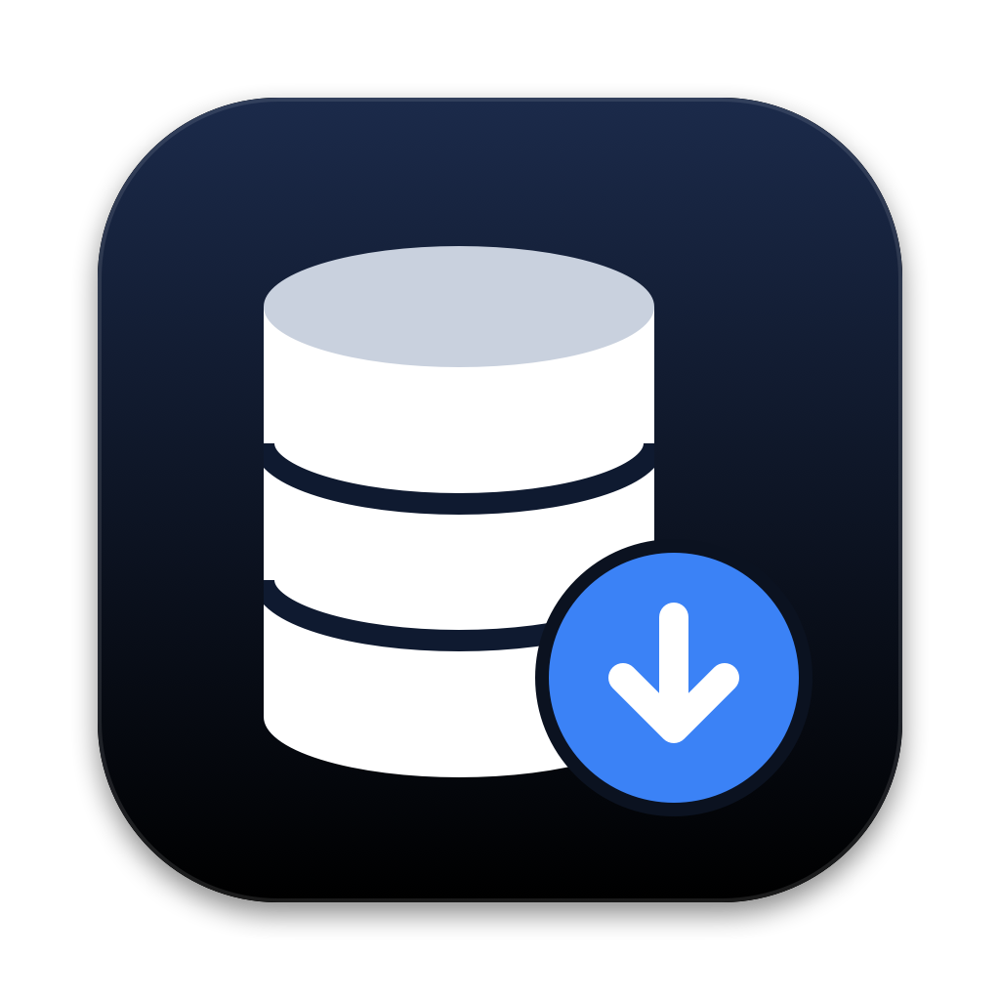

# SQL Server Setup for Mac

A one-click installer that gives a Mac (Apple Silicon or Intel) a local SQL Server for .NET coursework, plus an SSMS-style interface.

Open `dist/SQLServerSetup.dmg`, double-click **SQL Server Setup**, and it:

- installs whatever is missing (Rosetta, Docker Desktop, .NET SDK, VS Code) behind one password prompt
- starts SQL Server 2022 Developer Edition in Docker, sized to the Mac's RAM and CPUs
- sets up VS Code's SQL Server extension with a saved connection, then opens it on the Object Explorer (Databases, Security, Server Objects), like SSMS
- installs `dotnet-ef` and a `sqlserver` helper command

The app is signed with the Syntax Labs Developer ID and notarized, so Gatekeeper opens it without warnings.

## Sizing

| Mac RAM | SQL Server gets | CPUs |
|---|---|---|
| 8 GB | 2.5 GB (SQL Server's minimum) | 2 |
| 16 GB | 4 GB | half the cores |
| 24 to 32 GB | 6 GB | half, max 6 |
| 36 GB+ | 8 GB | max 6 |

Override with `MSSQL_MEMORY_MB` and `MSSQL_CPUS`. The server listens on `127.0.0.1` only.

## Everyday use

```
sqlserver ui                         open VS Code connected, Object Explorer like SSMS
sqlserver info                       server, login and connection string
sqlserver restore ~/Downloads/X.bak  restore a backup (Windows .bak files work)
sqlserver run script.sql             run a script
sqlserver stop | start | status      stop frees its RAM
```

Login details live in `~/.sqlserver-mac/connection.txt`.

## Development

```
./setup.sh              run setup directly
./tests/stress.sh       sandboxed tests: install scenarios, helper, VS Code merge, load at the 8 GB tier
./build-dmg.sh          build, sign and notarize (uses the Apple account signed in to Xcode)
NOTARIZE=0 ./build-dmg.sh   sign only
```

Needs Xcode and [XcodeGen](https://github.com/yonaskolb/XcodeGen) to build. The stress test uses its own container (`sqlstress`, port 14339) and never touches the real one.

- `setup.sh`: everything the installer does
- `app/`: the small Swift launcher that opens `setup.sh` in Terminal
- `assets/icon.swift`: draws the icon (`ICON=install|stack|ember`)
